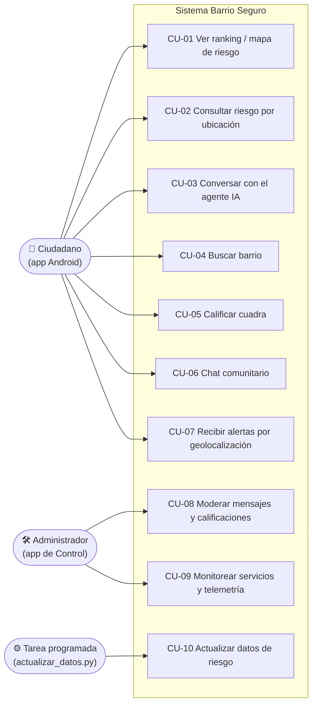
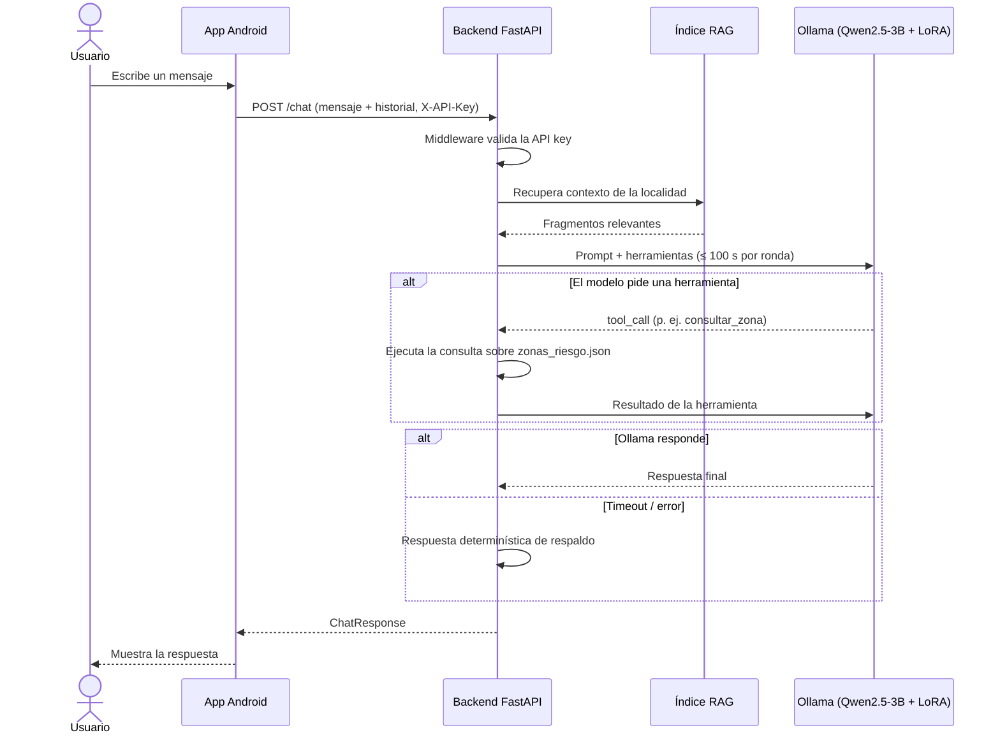
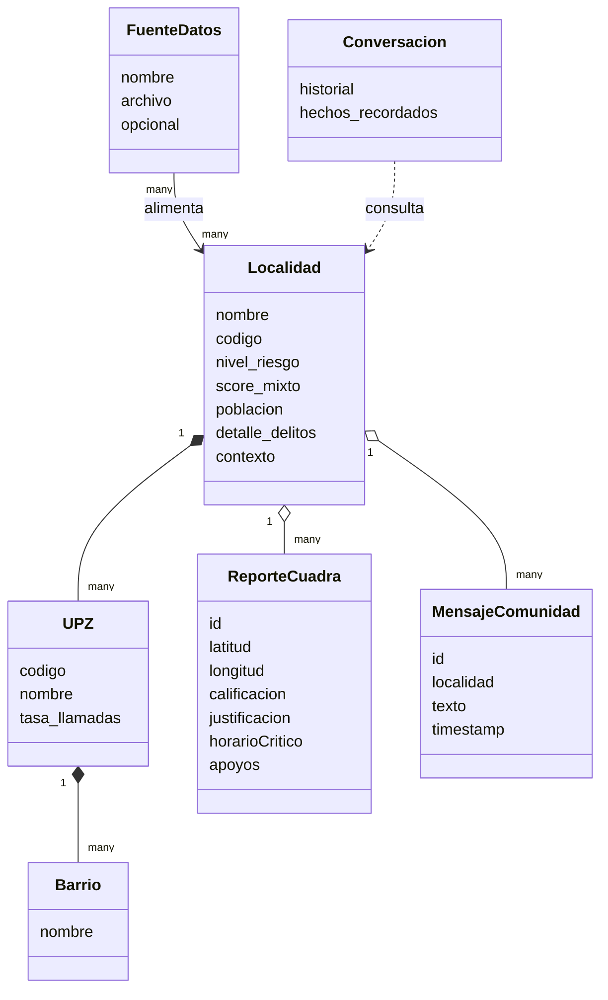

# Complemento al Documento de Arquitectura de Software (DAS)

Este documento resuelve los puntos marcados como **PENDIENTE** en
`Documento_Arquitectura_Software.docx`. Los diagramas están en Mermaid
(se ven directamente en GitHub y en VS Code / Android Studio con plugin).

> Los valores marcados como **[Propuesta]** son referencias razonables para el
> alcance académico; el equipo debe validarlos. Los marcados como
> **[Equipo]** requieren información que solo el equipo o el asesor tienen.

---

## 1.4 Casos de uso — diagrama

---

## 1.7 Requisitos no funcionales — métricas objetivo

| ID | Característica | Implementación actual | Métrica objetivo |
|---|---|---|---|
| RNF-01 | Desempeño | Timeout 100 s por ronda contra Ollama | **[Propuesta]** p95 ≤ 30 s en el chat con LLM en CPU; p95 ≤ 1 s en `/zonas`, `/riesgo`, `/barrios/buscar` |
| RNF-04 | Disponibilidad | Fuentes opcionales no rompen el pipeline | **[Propuesta]** 95 % mensual en servidor (Oracle Cloud Always Free); sin objetivo en ejecución local |
| RNF-05 | Seguridad | **Implementado:** API key (`X-API-Key`) + clave de administrador (`X-Admin-Key`), ver §6 | 0 endpoints de escritura/borrado o telemetría accesibles sin clave |

Cómo medir RNF-01: la app de Control ya registra `latencia_ms` por petición
en `/telemetria/actividad`; el p95 se calcula sobre ese historial.

---

## 1.9 Proceso de negocio previo

**[Equipo]** Confirmar si existía un proceso manual (p. ej. consulta directa
de los portales de datos abiertos o de la Policía). Si no existía, dejar
constancia de que el sistema crea una capacidad nueva en lugar de reemplazar
un proceso.

---

## 1.10 Diagrama de secuencia — CU-03 (chat con el agente)

---

## 2.1 Restricciones — RE-05 (plazo, presupuesto, asesor)

**[Equipo]** Completar:
- Fecha de entrega final: ________
- Presupuesto para infraestructura: ________ (el despliegue actual en
  `deploy/desplegar_oracle.sh` usa la capa gratuita, costo $0)
- Requisitos específicos del asesor: ________

---

## 2.2 Escenarios de atributos de calidad (completados)

| ID | Fuente | Estímulo | Artefacto | Respuesta | Medida |
|---|---|---|---|---|---|
| ESC-01 | Usuario | Envía un mensaje al chat | `/chat` | Responde con LLM o con el respaldo determinístico | **[Propuesta]** p95 ≤ 30 s; nunca sin respuesta |
| ESC-04 | Usuario no autorizado | Llama a un endpoint sin clave | Middleware de autenticación | Rechaza la petición | 401 en endpoints públicos (si hay `BARRIO_SEGURO_API_KEY`); 403 en telemetría y `DELETE` |
| ESC-05 | Administrador | Borra un mensaje ofensivo desde Control | `DELETE /comunidad/mensajes/{id}` | Desaparece para todos los usuarios | ≤ 5 s |
| ESC-06 | Operador | Se publican nuevos datos abiertos | `actualizar_datos.py` | Regenera `zonas_riesgo.json` sin tocar el código | 0 cambios de código |

**[Equipo]** Revisar si estos escenarios reflejan las prioridades reales.

---

## 3.3 Modelo de dominio — diagrama

---

## 6. Seguridad — decisión tomada

Se decidió **agregar un control de acceso mínimo** en lugar de solo aceptar
el riesgo:

| Variable de entorno | Cabecera | Protege | Si no está definida |
|---|---|---|---|
| `BARRIO_SEGURO_API_KEY` | `X-API-Key` | Todos los endpoints salvo `/health`, `/ping`, `/docs` | Endpoints públicos abiertos (compatibilidad con APK ya instaladas) |
| `BARRIO_SEGURO_ADMIN_KEY` | `X-Admin-Key` | `/telemetria/*` y todo `DELETE` | Solo se aceptan desde localhost directo (no por el túnel Cloudflare) |

Configuración:
- **Servidor:** exportar ambas variables antes de `run_api.py`.
- **App Android:** en `local.properties`, `barrio_seguro.api_key=<clave>` y recompilar.
- **App de Control:** exportar `BARRIO_SEGURO_ADMIN_KEY` antes de abrirla
  (el servidor que lanza hereda la variable).

Riesgo residual aceptado: la API key va dentro del APK, así que alguien con
experiencia podría extraerla. Para el alcance académico es suficiente; en
producción habría que usar autenticación por usuario (p. ej. Firebase Auth).
