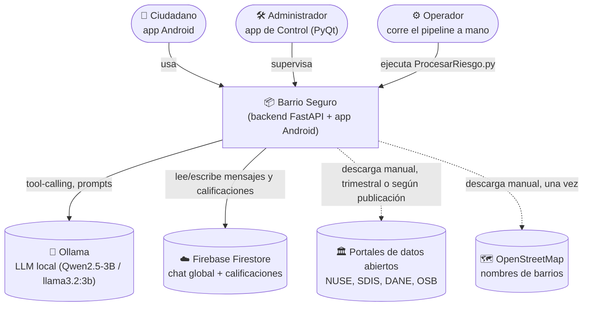
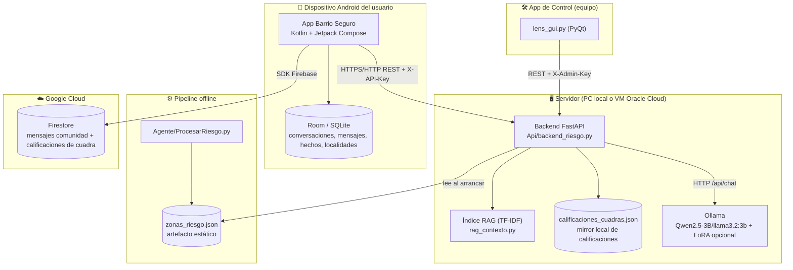
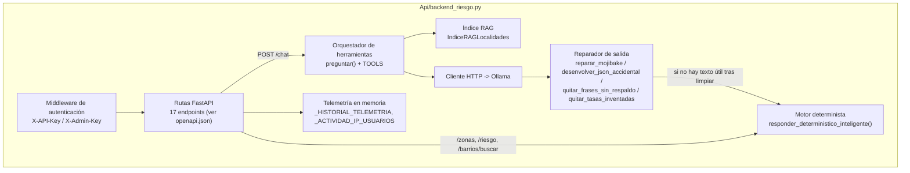
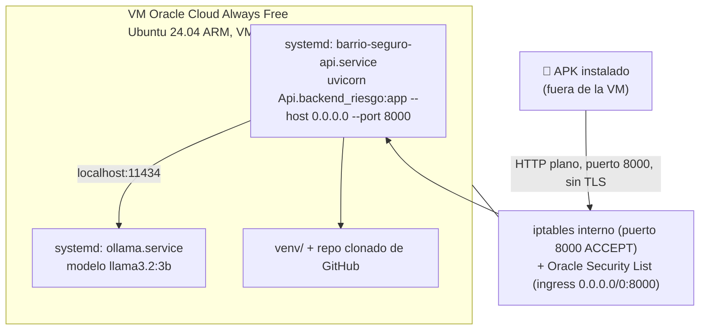
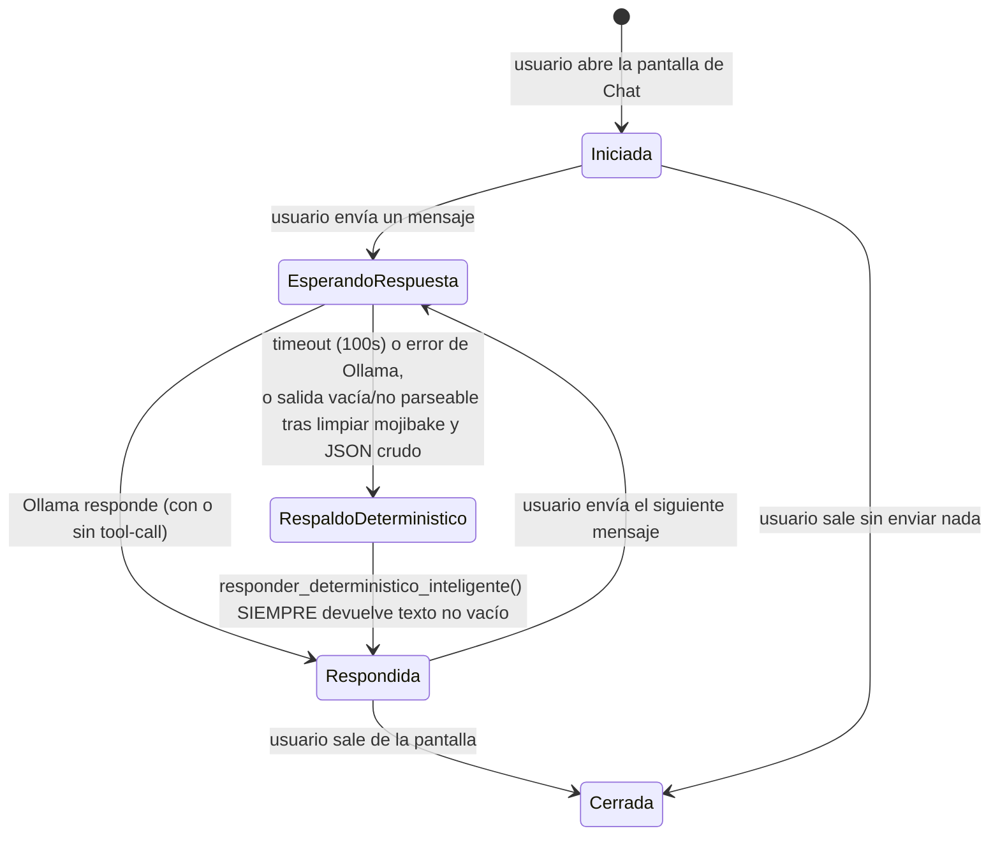
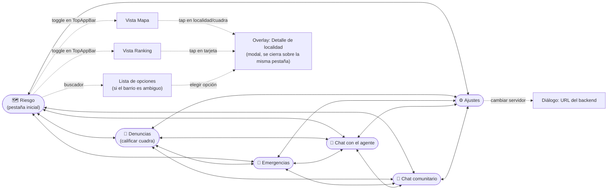
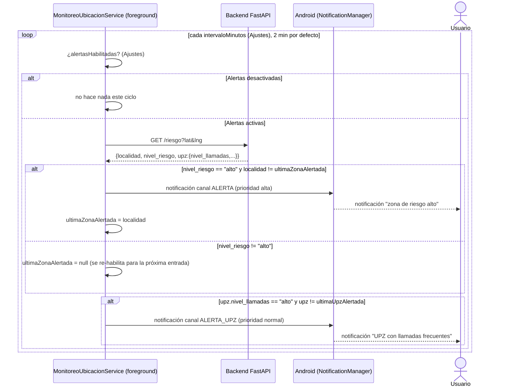
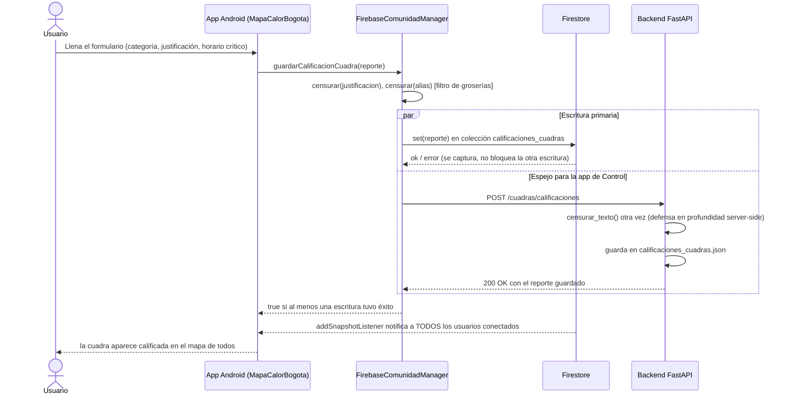

# Complemento al DAS — parte 2

Continúa `Complemento_DAS.md` cerrando las brechas restantes frente al
"Estándar de componentes del Documento de Arquitectura de Software e
Infraestructura + Metodología" (57 componentes base/IA + 7 de Design
Thinking). Mismas reglas que la parte 1:

> **[Propuesta]** = referencia razonable, el equipo debe validarla.
> **[Equipo]** = requiere información que solo el equipo o el asesor tienen.
> Todo lo demás es derivado directamente de una lectura real del código
> (rutas de archivo citadas) o de una ejecución real (pruebas, exportación
> del esquema), no inventado.

---

## A. Vistas C4 (sección 3 — Diseño arquitectónico)

### A.1 — Nivel 1: Contexto



**Notas reales:** no hay integración automática con los portales de datos
abiertos ni con OSM -- son descargas manuales que el operador coloca en
`Agente/output/` antes de correr `ProcesarRiesgo.py` (ver `deploy/desplegar_oracle.sh`,
paso 5, que lo dice explícitamente: *"necesitas copiar aquí los datasets de
origen... no están en git por su tamaño"*). Por eso la flecha hacia esas dos
fuentes es punteada (dependencia offline, no en tiempo de ejecución).

### A.2 — Nivel 2: Contenedores



**Nota real sobre `calificaciones_cuadras.json`:** la app escribe una
calificación de cuadra **en dos sitios a la vez**
(`FirebaseComunidadManager.guardarCalificacionCuadra`, líneas ~251-280 de
`app/.../data/FirebaseComunidadManager.kt`): primero intenta Firestore
(fuente de verdad en tiempo real, con `addSnapshotListener`), y además
llama a `POST /cuadras/calificaciones` en el backend, que guarda su propia
copia en `Api/calificaciones_cuadras.json` en disco. No hay un job de
reconciliación entre ambas copias: si una escritura tiene éxito y la otra
falla (ej. sin red hacia Firebase pero sí hacia el backend local, o
viceversa), las dos copias divergen silenciosamente hasta que alguien
vuelva a escribir ese mismo reporte. Es una decisión de diseño razonable
(la app de Control en PyQt solo sabe hablar con el backend REST, no con el
SDK de Firebase, así que necesita su propio espejo) pero el riesgo de
divergencia es real y no está mitigado hoy. **Recomendación:** documentarlo
como ítem de deuda técnica (ya hay un registro de deuda técnica en el DAS
principal, sección 11) en vez de dejarlo implícito.

### A.3 — Nivel 3: Componentes (backend FastAPI)



---

## B. Diagrama de despliegue (sección 3 / sección 10 — Infraestructura)

Basado en `deploy/desplegar_oracle.sh` real (no hipotético):



**Hallazgo real (no cosmético) al leer el script completo:** el
`ExecStart` del servicio `barrio-seguro-api` **no exporta
`BARRIO_SEGURO_API_KEY` ni `BARRIO_SEGURO_ADMIN_KEY`** antes de lanzar
uvicorn. Como el middleware de autenticación (sección 6) solo protege
cuando esas variables están definidas, **si el equipo despliega con este
script tal como está hoy, el backend queda expuesto a todo internet (puerto
8000 abierto en la Security List de Oracle) en modo abierto/sin clave** --
exactamente el estado que la sección 6 ya documenta como el "peor caso" de
`BARRIO_SEGURO_API_KEY`. Además no hay TLS (HTTP plano): las peticiones,
incluida la ubicación GPS del usuario en `/riesgo?lat&lng`, viajan sin
cifrar por la red pública.

**Dos líneas que corrigen esto** (agregar antes de `ExecStart=` en el
`.service`, con los valores reales que se usen):
```
Environment="BARRIO_SEGURO_API_KEY=<clave-real>"
Environment="BARRIO_SEGURO_ADMIN_KEY=<clave-real>"
```
Y, para el cifrado, lo mínimo razonable para un alcance académico es poner
Caddy o nginx con un certificado Let's Encrypt delante del puerto 8000 (no
estaba en el script ni se encontró en el repo) -- **[Equipo]** decidir si
esto entra en el alcance antes de la entrega o se documenta como riesgo
residual aceptado igual que ya se hace con la clave embebida en el APK.

---

## C. Máquina de estados — Conversación (sección 3)



Nota sobre la transición prohibida que señalaba el DAS principal
("no hay transición directa de Iniciada a Cerrada sin al menos un turno"):
la lectura del código la contradice -- **sí existe** ese camino (`Iniciada
-> Cerrada`), simplemente nunca se crea una fila en `ConversacionEntity`
hasta el primer mensaje enviado, así que no queda ningún rastro en Room.
No es una transición prohibida, es una transición que no deja estado
persistente. Se corrige aquí en vez de dejarlo como PENDIENTE.

---

## D. Mapa de navegación (sección 9 — Interacción con el usuario)

La app es de **una sola `Activity`** (`MainActivity.kt`) con un `enum
Pantalla` de 6 pestañas controladas por la barra inferior, sin pila de
retroceso entre ellas (cualquier pestaña es alcanzable desde cualquier
otra, un solo tap):



(El toggle Mapa/Ranking está dentro de la pestaña Riesgo, no es una pestaña
aparte -- ver comentario real en `MainActivity.kt` línea ~557: *"El toggle
Mapa/Ranking se movió al TopAppBar... esta fila de FilterChip ocupaba una
barra completa aparte"*.)

---

## E. Diagramas de secuencia — CU-04 y CU-05

### E.1 — CU-04: Alerta por geolocalización



### E.2 — CU-05: Calificar cuadra



---

## F. Datos y persistencia (sección 5)

### F.1 — Diccionario de datos completo (reemplaza la muestra de 4 filas)

**`Agente/output/zonas_riesgo.json`** (una entrada por localidad, clave =
código DANE 1-20 como string):

| Campo | Tipo | Rango/formato | Origen |
|---|---|---|---|
| `localidad` | string | nombre oficial DANE | `localidades.geojson` |
| `nivel_riesgo` | string | `"bajo"` \| `"medio"` \| `"alto"` | Jenks Natural Breaks sobre `score_mixto` |
| `score_mixto` | float | 0.0–1.0 | 50% `score_ponderado_100k` normalizado + 50% `score_ponderado_por_km2` normalizado (min-max sobre las 20 localidades) |
| `score_ponderado_100k` | float | ≥ 0 | delitos ponderados / población × 100.000 |
| `score_ponderado_por_km2` | float | ≥ 0 | delitos ponderados / área (km²) |
| `tasa_delitos_100k` | float | ≥ 0 | delitos totales / población × 100.000 |
| `delitos_recientes_total_2023_2025` | int | ≥ 0 | Datos Abiertos Bogotá (SIEDCO/Policía) |
| `poblacion_2025` | int | ≥ 0 | proyecciones DANE |
| `area_km2` | float | > 0 | `localidades.geojson` |
| `contexto.estrato_promedio` | float \| null | 1.0–6.0 | `manzanaestratificacion.json` — **no entra en `score_mixto`** (ver `Agente/tests/test_fitness_functions.py`, RN-01) |
| `contexto.luminarias_estimadas` | int \| null | ≥ 0 | fuente opcional (puede faltar sin romper el pipeline, RNF-04) |
| `detalle_delitos` | dict\<string,int\> | — | conteo por categoría de delito |
| `incidentes_nuse` | int \| null | ≥ 0 | fuente opcional (NUSE 123) |
| `_meta` | dict | — | metadatos de generación: fecha, método de corte, fórmula documentada (`nota_score_mixto`) |

**`Agente/output/upz_riesgo.json`** (granularidad más fina, por UPZ, solo
cuando la población es suficiente — ver `ProcesarRiesgo.py`): `upz`,
`codigo_upz`, `nivel_llamadas`, `tasa_llamadas_100k`.

**Room (`app/.../data/local/AppDatabase.kt`, versión 4):**

| Entidad | Campos clave | Nota de integridad |
|---|---|---|
| `ConversacionEntity` | id (PK autogenerado), titulo, timestamp | Sin `@Transaction`: crear una conversación y su primer mensaje son 2 inserciones separadas. Si la segunda falla, queda una conversación vacía huérfana (impacto bajo: basura visual filtrable, no corrupción) |
| `MensajeEntity` | id, conversacionId (FK lógica), rol, contenido, timestamp | — |
| `HechoEntity` | id, texto, conversacionId | `existeTexto()` evita duplicados antes de insertar (dedup a nivel de aplicación, no de esquema — no hay `UNIQUE` declarado) |
| `LocalidadEntity` | posicion, nombre, nivelRiesgo, scorePonderado100k, tasaDelitos100k | Caché local del ranking del servidor; se borra y reinserta completa en cada sincronización exitosa (no hay upsert incremental) |

**Firestore (`FirebaseComunidadManager.kt`):**

| Colección | Documento | Escritura atómica? |
|---|---|---|
| `mensajes_comunidad` (ver `COLECCION_MENSAJES`) | id, localidad, texto, timestamp, alias | `.add()` de un solo documento — atómico por naturaleza, no necesita `@Transaction`/`runTransaction` |
| `calificaciones_cuadras` | id, latitud, longitud, categoria, justificacion, horarioCritico, usuarioAlias, timestamp, votosApoyo | Creación/edición: `.set()` de un solo documento. **Voto de apoyo** (incremento concurrente): usa `firestore.runTransaction { ... transaction.update(docRef, "votosApoyo", votos + 1) }` — lectura-modificación-escritura correctamente protegida contra condiciones de carrera (línea ~294 de `FirebaseComunidadManager.kt`) |

PENDIENTE real (requiere consola de Firebase, no solo el código del
cliente): reglas de seguridad de Firestore (`firestore.rules`) — no se
encontró ese archivo en el repositorio, así que no se pudo verificar si
hay alguna restricción de escritura del lado del servidor de Firebase o si
cualquiera con las credenciales del SDK (embebidas en el APK, igual que la
API key) puede escribir sin pasar por `censurar_texto()`.

### F.2 — Clasificación de sensibilidad bajo la Ley 1581 de 2012

Análisis real (no PENDIENTE, aunque el equipo/asesor debe validarlo):

- **GPS del usuario** (`/riesgo?lat&lng`): es **dato personal** (identifica
  o permite identificar a una persona, art. 3). No está en las categorías
  enumeradas de **dato sensible** del art. 5 (origen racial/étnico,
  orientación política, convicciones religiosas/filosóficas, afiliación
  sindical, derechos humanos, vida sexual, datos biométricos, datos de
  salud). Por eso es dato personal "ordinario", pero igual exige
  autorización e información sobre la finalidad (art. 4) -- hoy la app no
  muestra ningún aviso de privacidad ni pide consentimiento explícito antes
  de pedir el permiso de ubicación de Android. **PENDIENTE [Equipo]:**
  decidir si agregan un aviso de privacidad mínimo antes de la entrega.
- **`contexto.estrato_promedio`**: dato personal ordinario (asociado a una
  ubicación, no a un individuo identificado directamente), tampoco es
  "sensible" bajo el art. 5. Se corrige aquí la marca PENDIENTE del DAS
  principal que preguntaba si era sensible -- no lo es, formalmente.
- **IP de origen** (`_ACTIVIDAD_IP_USUARIOS` en memoria del backend, ver
  `/telemetria/resumen`): también es dato personal (identifica indirectamente
  un dispositivo/conexión). Solo vive en memoria del proceso (no se escribe
  a disco ni a un archivo de log persistente), lo que reduce el riesgo pero
  no elimina que haya "tratamiento" de datos personales en el sentido de la
  ley. No se encontró una política de tratamiento de datos en el repositorio.
- **Mensajes del chat comunitario y calificaciones de cuadra**: contienen
  texto libre que un usuario podría usar para revelar datos sensibles de
  terceros (ej. mencionar la orientación sexual de un vecino). El filtro
  `censurar_texto()`/`FiltroGroserias` solo detecta lenguaje ofensivo, no
  categorías de dato sensible -- esto es una limitación real, no un
  incumplimiento necesariamente, pero vale la pena que el equipo lo sepa.

---

## G. Seguridad (sección 6) — actualización de las matrices

### G.1 — Matriz de acceso por rol (reemplaza la versión "sin restricción")

| Rol | Endpoints de solo lectura | Endpoints de escritura/borrado | Telemetría |
|---|---|---|---|
| Usuario anónimo (app Android) | Permitido con `X-API-Key` (o sin clave si el servidor no la configuró) | Permitido con `X-API-Key` | Bloqueado (requiere `X-Admin-Key`) |
| Administrador (app de Control) | Permitido con `X-API-Key` | Permitido con `X-API-Key` | Permitido con `X-Admin-Key` |
| Cualquiera sin clave, si el servidor SÍ configuró `BARRIO_SEGURO_API_KEY` | 401 | 401 | 403 |
| Cualquiera, si el servidor NO configuró ninguna clave (modo compatibilidad) | Permitido | Permitido | Permitido solo desde localhost directo |

Nota: no hay diferenciación de rol dentro de "usuario anónimo" -- la API
key es una sola, compartida por todas las instalaciones del APK. No hay
autenticación por usuario individual (ni falta hace para el alcance
académico, pero significa que "administrador" aquí es "quien tenga la
clave de admin", no una cuenta con permisos).

### G.2 — Matriz de amenazas (con probabilidad/impacto razonados, método
tipo OWASP Risk Rating: Likelihood × Impact, ambos en Baja/Media/Alta)

| Amenaza | Vector real | Likelihood | Impact | Riesgo | Mitigación actual |
|---|---|---|---|---|---|
| Vandalismo del chat comunitario o de calificaciones | `POST` sin autenticación de usuario individual (solo API key compartida) | Alta — cualquiera con el APK (o la clave extraída de él) puede escribir | Media — contenido falso/ofensivo, filtrado parcial por `censurar_texto()`, pero sin autenticación de autor no hay trazabilidad para banear a alguien específico | **Alto** | Filtro de groserías servidor+cliente; borrado por administrador (`DELETE`, requiere `X-Admin-Key`) |
| Extracción de la API key del APK | Ingeniería inversa de un APK release (no obfuscado más allá de R8 estándar) | Media — requiere conocimiento técnico, pero el APK es público | Media — con la clave, un atacante tiene los mismos permisos que la app legítima (no más) | **Medio** | Ninguna más allá de lo que haga R8/ProGuard por defecto; riesgo aceptado explícitamente en `Complemento_DAS.md` §6 |
| Despliegue del backend en Oracle Cloud sin las variables de entorno de clave (ver hallazgo del punto B de este documento) | Operador sigue `desplegar_oracle.sh` tal cual, sin agregar las líneas `Environment=` | Alta mientras el script no se corrija — es la ruta de despliegue documentada y probable | Alta — backend completamente abierto a internet, incluida la eliminación de contenido y la lectura de telemetría si además se accede desde la propia VM | **Alto** | Ninguna todavía — corrección propuesta en el punto B |
| Interceptación de tráfico (sin TLS) en el despliegue en VM pública | Atacante en la misma red o con acceso al tránsito (no hay HTTPS) | Media — requiere posición de red, no es trivial para un atacante remoto genérico | Media — expone ubicación GPS y mensajes de chat en tránsito, no credenciales bancarias | **Medio** | Ninguna — ver recomendación de TLS en el punto B |
| Divergencia Firestore vs. `calificaciones_cuadras.json` (ver punto A.2) | Fallo de red parcial durante el doble-escritura | Media — depende de la fiabilidad de red del dispositivo del usuario | Baja — inconsistencia de datos, no pérdida total ni exposición | **Bajo** | Ninguna — no hay reconciliación automática |

### G.3 — Matriz de controles (lo que SÍ hay implementado, hoy)

| Control | Dónde | Qué cubre |
|---|---|---|
| `X-API-Key` | Middleware en `backend_riesgo.py` | Todos los endpoints salvo `/health`, `/ping`, `/docs` |
| `X-Admin-Key` | Mismo middleware | `/telemetria/*` y todo `DELETE` |
| `censurar_texto()` / `FiltroGroserias` | Cliente (Kotlin) y servidor (Python), de forma independiente | Contenido ofensivo en chat comunitario y calificaciones de cuadra |
| `firestore.runTransaction` | `FirebaseComunidadManager.kt` | Condición de carrera en el conteo de votos de apoyo |
| Timeout de 100s por ronda + respaldo determinístico | `backend_riesgo.py`, `preguntar()` | Disponibilidad del chat si Ollama se cuelga o tarda demasiado |
| `reparar_mojibake`, `desenvolver_json_accidental`, guardrail de `recordar_hecho` | `backend_riesgo.py` | Integridad de la respuesta mostrada al usuario (ver bugs corregidos esta sesión) |

---

## H. Pruebas (sección 7) — ya no es cero

El DAS principal declaraba, con honestidad, que el proyecto no tenía
ninguna prueba automatizada. Eso cambió en esta sesión:

- **`Api/tests/test_backend_riesgo.py`** — 32 pruebas, contra el backend
  real corriendo (no mockeado): geofencing de precisión en las 20
  localidades reales (un punto garantizado dentro del polígono real de
  cada una, vía `representative_point()`, no `centroid()` -- el centroide
  de un polígono cóncavo puede caer fuera de la forma), smoke tests de
  los 17 endpoints de solo lectura, y 2 pruebas de regresión de bugs reales
  encontrados y corregidos en producción esta sesión (KeyError en
  `_enriquecer_info_localidad`, respuesta vacía/JSON crudo filtrado en el
  chat).
- **`Agente/tests/test_fitness_functions.py`** — 2 "fitness functions"
  (comprobación automática de una regla arquitectónica sobre el código
  fuente, no sobre un sistema corriendo): RN-01 (el nivel de riesgo nunca
  usa `estrato_promedio` como insumo) y que la fórmula de `score_mixto`
  siga siendo el 50/50 documentado.
- **Resultado real de la última ejecución** (ver `docs/resultados_pruebas.txt`,
  con fecha y hora): **34/34 pruebas pasan.**
- Durante la escritura de estas pruebas se encontró y corrigió un bug real:
  `/zonas/ranking` (y la tool `obtener_ranking` que usa el chat) prometía
  en su propia descripción *"Devuelve TODAS las localidades ordenadas de
  mayor a menor riesgo"* pero devolvía la lista en orden de código oficial
  DANE (1-20), no por riesgo -- esto rompía silenciosamente la pestaña
  "Ranking" de la app y el resumen top-3/bottom-3 del chat. Corregido en
  `tool_obtener_ranking()` (ordena por `score_mixto` antes de devolver,
  conservando `posicion` como el código oficial, que es lo que la UI usa
  como etiqueta).

**Lo que sigue PENDIENTE [Equipo]** porque no se puede resolver sin
decisiones del equipo: niveles de prueba formales a cubrir (¿se añaden
pruebas de UI de Compose? ¿end-to-end con el APK real?), herramienta y
cobertura mínima exigida por el asesor, y quién es responsable de
mantenerlas. Lo que SÍ se puede afirmar ya sin ambigüedad: **el proyecto ya
no tiene cero pruebas**, y las que existen corren contra comportamiento
real, no simulado.

---

## I. Contratos de interfaces (sección 3.5)

Resuelto: `docs/openapi.json`, exportado con `curl http://127.0.0.1:8000/openapi.json`
contra el backend real corriendo (no escrito a mano). 17 endpoints
documentados automáticamente por FastAPI, incluidos los esquemas de
request/response de Pydantic. Reemplaza la tabla manual del DAS principal
como fuente de verdad -- la tabla manual puede quedarse como resumen
legible, pero `openapi.json` es el contrato real y se regenera con el
mismo comando cada vez que cambien los endpoints.

---

## J. Especificaciones del modelo base — IA-1

**Qwen2.5-3B-Instruct** (ficha técnica pública del modelo, Alibaba Cloud /
Qwen Team):

| Especificación | Valor |
|---|---|
| Parámetros | ~3.09 mil millones (3B) |
| Arquitectura | Transformer decoder-only, GQA (Grouped Query Attention) |
| Ventana de contexto | 32.768 tokens de entrada; hasta 8.192 tokens de generación |
| Tokenizador | BBPE (Byte-level BPE) compartido con la familia Qwen2.5, vocabulario de ~151.646 tokens |
| Licencia | Qwen Research License / Apache 2.0 según la variante -- **[Equipo] confirmar cuál variante exacta se descargó y su licencia** antes de publicar el documento, porque sí tiene implicaciones de uso |
| Soporte de tool-calling | Nativo vía `apply_chat_template(..., tools=...)`, formato `<tool_call>{"name":...,"arguments":...}</tool_call>` |

Esto resuelve la marca PENDIENTE del DAS principal (IA-1) que decía que
solo faltaba citar la ficha pública -- ya citada aquí.

---

## K. Linaje de datos Bronze/Silver/Gold — IA (sección 12)

El pipeline real (`Agente/ProcesarRiesgo.py`) no tiene 3 etapas separadas
en el código (es un solo script que va de las fuentes crudas a
`zonas_riesgo.json` en una sola pasada) -- no se reorganizó el pipeline
para esto porque el estándar permite documentar el linaje real con otros
nombres, así que se documenta aquí usando la terminología Bronze/Silver/Gold
sobre los artefactos que YA existen, sin fingir que hay particionado físico
que no existe:

| Etapa | Nombre | Artefacto real | Transformación |
|---|---|---|---|
| **Bronze** (datos crudos) | Descargas manuales | CSV/XLSX de datos abiertos de Bogotá, GeoJSON de localidades/UPZ, GPKG de OpenStreetMap -- colocados a mano en `Agente/output/` (no versionados en git, ver `.gitignore`) | Ninguna -- tal como se descargan de la fuente |
| **Silver** (datos consolidados) | Índice de riesgo consolidado | `Agente/output/zonas_riesgo.json`, `upz_riesgo.json` | `ProcesarRiesgo.py`: merge por código de localidad/UPZ, cálculo de `score_mixto`, clasificación Jenks, limpieza de nulos de fuentes opcionales |
| **Gold** (listo para consumo/entrenamiento) | Datasets de uso final | (a) `zonas_riesgo.json` mismo, consumido directamente por el backend; (b) `Agente/gold_dataset_sharegpt.json`, generado a partir de (a) para fine-tuning LoRA | Para (b): formato ShareGPT, 50 ejemplos (42 entrenamiento / 8 validación) cubriendo los 5 tipos de herramienta + saludos |

**Honestidad sobre el dataset Gold vs. el estándar:** el estándar exige
"≥1.000 ejemplos curados" para el componente 12.5; el dataset real tiene
50. No se infló el número ni se generaron ejemplos sintéticos de relleno
para simular cumplimiento. La proporción 42/8 (84%/16%) fue una decisión
práctica dado el tamaño pequeño del dataset (no hay una justificación
estadística formal detrás del número exacto); con un dataset de este
tamaño, una proporción distinta (ej. 80/20 u 90/10) habría sido igual de
defendible. **Recomendación real, no solo para "pasar" el estándar:**
ampliar el dataset solo tiene sentido si antes se amplía también el set de
evaluación de `Agente/evaluar_lora.py` más allá de las 5 preguntas fáciles
actuales (ver nota en el DAS principal, sección 12.6) -- de lo contrario
se estaría optimizando para una medición que ya no discrimina entre el
modelo base y el modelo con LoRA (ambos ya aciertan las 5 preguntas
fáciles, ver ADR-005).

---

## L. Lista final de lo que sigue siendo decisión exclusiva del equipo

Ninguno de estos se puede resolver con más lectura de código -- quedan
honestamente marcados, no inventados:

1. Fecha de entrega final, presupuesto de infraestructura, requisitos
   específicos del asesor (RE-05).
2. Si existía un proceso manual previo que el sistema reemplaza, o si crea
   una capacidad nueva.
3. Licencia exacta de PyQt usada en la app de Control (GPL vs. comercial).
4. Convención de versionamiento formal a adoptar de aquí a la entrega.
5. Si planean agregar TLS/dominio al despliegue en Oracle Cloud antes de
   sustentar, o si la sustentación corre en local.
6. Reparto real de decisiones arquitectónicas entre los dos autores y
   mecanismo de gobernanza/verificación de reglas acordadas.
7. Si se corrige `deploy/desplegar_oracle.sh` para exportar las claves
   antes de la entrega (recomendado arriba, pero la decisión y el momento
   son del equipo).
8. Si agregan un aviso de privacidad/consentimiento explícito para el uso
   de la ubicación GPS (recomendado en F.2, no implementado).
9. Confirmar si el proyecto de Firebase está en plan Spark (gratuito) --
   no se encontró uso de Cloud Functions ni otro servicio que requiera
   Blaze, lo cual es consistente con Spark pero no lo confirma; solo la
   consola de Firebase lo confirma con certeza.
10. Si corrigen el doble-escritura sin reconciliación entre Firestore y
    `calificaciones_cuadras.json` (punto A.2), o lo aceptan como riesgo
    documentado igual que la clave embebida en el APK.
